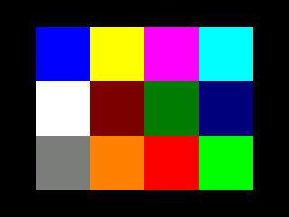

# Direct camera preview

Experimental components for ESPHome 2026.10.0 and ESP-IDF. Mainline
`esp32_camera` captures baseline 320x240 JPEG; `camera_link_sender` answers one
request at a time, while `camera_link_viewer` decodes directly to a fixed 320x240 RGB565
buffer, scaled by LVGL to 240x180. No microphone component is required. Hardware acceptance is pending.

## Wiring and recovery

Use CoreS3 blue Port C: yellow Core RX17 to Cam TX20, white Core TX18 to Cam RX19,
plus 5 V and ground through the Grove cable. Configure both UARTs for 2,000,000
baud, 8N1, no flow control. Give the sender an 8192-byte TX ring and the viewer a
16384-byte RX ring. UART19/20 replaces the camera's USB application interface;
select UART0 logging and keep encrypted Wi-Fi API/OTA enabled. Initial flashing
and ROM recovery use the supplied Grove-to-USB-C adapter with labeled G0/GND
bridged during USB power-on; remove the jumper after entering download mode.
[Manufacturer hardware and download procedure](https://docs.m5stack.com/en/unit/Unit_CamS3-5MP).

CamS3-5MP uses 16 MB flash, 8 MB octal PSRAM, SDA17/SCL41, XCLK11,
VSYNC42/HREF18/PCLK12, data6/15/16/7/5/10/4/13, reset21. Conservative initial
PSRAM40MHz and XCLK10MHz are trial settings, not a proven remedy for capture faults.
The built-in esp32-camera2.1.7 PY260 driver has limited generic control support;
verify exposure and orientation on real images. Native 5MP still capture requires
later integration; ESPHome's 2560x1920 option does not match this sensor's mode.

## Wire protocol v1

Every message has a 20-byte header:

| Offset | Length | Meaning |
| --- | --- | --- |
| 0 | 4 | ASCII `CAM1` |
| 4 | 1 | Type: REQUEST=1, FRAME=2, STOP=3 |
| 5 | 1 | Version, exactly 1 |
| 6 | 2 | Reserved, zero |
| 8 | 4 | Unsigned sequence, little endian |
| 12 | 4 | Payload length, little endian |
| 16 | 4 | CRC32, little endian |

CRC is IEEE reflected CRC32, polynomial0xEDB88320, initial/final XOR0xFFFFFFFF,
covering header bytes4..15 followed by the payload, excluding magic and CRC.
REQUEST/STOP have zero payload; FRAME has 1..65536 bytes. Allocation never uses a
wire-supplied length. Only baseline, 8-bit, 320x240 JPEG with SOI/EOI is passed to
the decoder. Header inspection is not a claim that entropy data is valid.

Viewer sequence starts randomly on boot and increments across page changes.
Only a matching pending sequence can display. A sender compares camera frame
driver capture/DMA timestamps against the request timestamp and discards queued older frames;
recapture is scheduled after the callback returns. There is no promise of exact
exposure control. Random sequence initialization prevents deterministic reboot
reuse; accidental collision remains possible at 1 in 2^32.

Receive inactivity500ms resets a partial parser. Requests and sends have absolute
2s deadlines, independent of incoming progress. Invalid/corrupt messages are
ignored, followed by timeout/retry. Header resynchronization is bounded but can
lose an additional packet after inserted/deleted bytes; the next transaction
recovers. STOP cancels pending capture, and a frame already being sent finishes
or reaches its deadline to avoid splicing headers into a payload. Page exit and
shutdown release the viewer's high-frequency loop request. OTA hooks must disable
sender/viewer before upload and restore sender on failed OTA.

## Image ownership and scheduling

All UART and LVGL operations run in the main loop. The camera shared pointer
keeps the JPEG alive until it has been copied into the UART TX ring. Transmission
only writes currently available ring capacity, bounded to2048bytes per loop.
Viewer drains up to8192bytes per loop. A16384-byte RX ring tolerates about82ms of
stall at2Mbaud. A high-frequency loop removes normal sleep but cannot prevent
blocking peripheral work; test combined display, NFC, audio, Wi-Fi, and OTA load.

Before each decode the old LVGL image is hidden, detached, and evicted from cache.
The fixed RGB buffer remains allocated throughout the component's lifetime.
JPEGDEC1.8.4 decodes baseline QVGA directly into little-endian RGB565 blocks; bounded
row copies avoid RuntimeImage's per-pixel RGB8888 conversion/scaling. Actual JPEG
mode/dimensions, block bounds, complete pixel count, decoder success, and the
absolute publication deadline all pass before showing it. LVGL scales 320x240
by 192/256 to 240x180. Code generation explicitly enables
`LV_DRAW_SW_SUPPORT_RGB565A8`: LVGL requires this alongside RGB565 support for
opaque RGB565 transforms. Leaving it disabled skips transform output and can
blend uninitialized pixels. The image itself remains opaque RGB565.
The JPEG and RGB buffers occupy 65536+153600 bytes, plus the
RX ring, decoder, and LVGL storage. The decoder is closed after every opened session; failure leaves the widget hidden. Cache
and widget invalidation occur on each successful publication. The next request
waits until decoding finishes plus100ms; stale displayed images blank after2s.

Debug logs report completed frames, maximum JPEG size, request roundtrip, maximum
loop gap, parser errors, internal free/largest block, and free PSRAM. These are
observations, not guarantees of frame rate or scene-to-screen latency.

## Verification

`tests/protocol_test.cpp` exercises length65536, bad lengths, type/CRC corruption,
byte deletion/insertion, timeout resets, sequence wrap, baseline-header rejection,
and deterministic noise under AddressSanitizer/UBSan. Run with a host C++17 compiler:

```sh
g++ -std=c++17 -Wall -Wextra -Werror -fsanitize=address,undefined tests/protocol_test.cpp -o /tmp/camera-link-test
/tmp/camera-link-test
```

`tests/run.sh` also compiles the actual sender/viewer implementation against small
host fakes for UART, time, camera, decoder, and LVGL. It exercises expired final
bytes/callbacks, capture freshness retry, a decode crossing the deadline, decoder
failure, stale blanking, send timeout, shutdown, and pause/resume. The fake decoder does not establish real JPEGDEC behavior; hardware OTA
interruption is still required. `viewer_decoder_test.cpp` also runs the actual
viewer with the real JPEGDEC library against committed synthetic color bars and a 4x3 color grid,
truncated/invalid-entropy, progressive, and wrong-size fixtures. That check passes
AddressSanitizer, including successful recovery and 300 grid samples across rows
and MCU boundaries. Set `JPEGDEC_SOURCE` to the JPEGDEC1.8.4 checkout when running
`tests/run.sh`; without it, the script explicitly reports the real decoder skipped.
The upstream UBSan limitations below still apply.

`tests/run-lvgl.sh` builds the real LVGL sources against the dashboard-generated
`lv_conf.h`, adapting only the allocator and draw-unit startup for a standalone
host. Set `LVGL_SOURCE`, `LVGL_CONFIG`, and `LVGL_TEST_OUTPUT`. It verifies the
regression with RGB565A8 disabled, then requires all 36 interior grid samples
across three replacements of the same buffer/descriptor to match with it enabled.
The tested dashboard sources identify LVGL9.5.0. Synthetic captures:

| Transform feature disabled | Transform feature enabled |
| --- | --- |
|  |  |

A separate host check of the dashboard's real JPEGDEC1.8.4 accepted a generated
QVGA baseline and rejected truncated/invalid entropy. Progressive and wrong-size
fixtures were excluded by the corresponding header gates. AddressSanitizer found
no memory error, but UBSan reported upstream unaligned loads and negative shifts,
including on the valid image. This is not a clean sanitizer result for JPEGDEC,
and does not establish behavior on the ESP32-S3. No upstream code is changed here.

A dashboard build and actual board tests remain mandatory. Acceptance includes
standalone sensor/PSRAM readback and repeated decodable captures, fresh scenes
after long idle, repeated page enter/exit, malformed JPEG decoder failures,
missing/rebooted camera recovery, stressed NFC/beeps, OTA, and sustained heap/stack
measurements. Shared Grove power, high-resolution capture, storage/upload, deep
sleep, and battery runtime are separate work.
